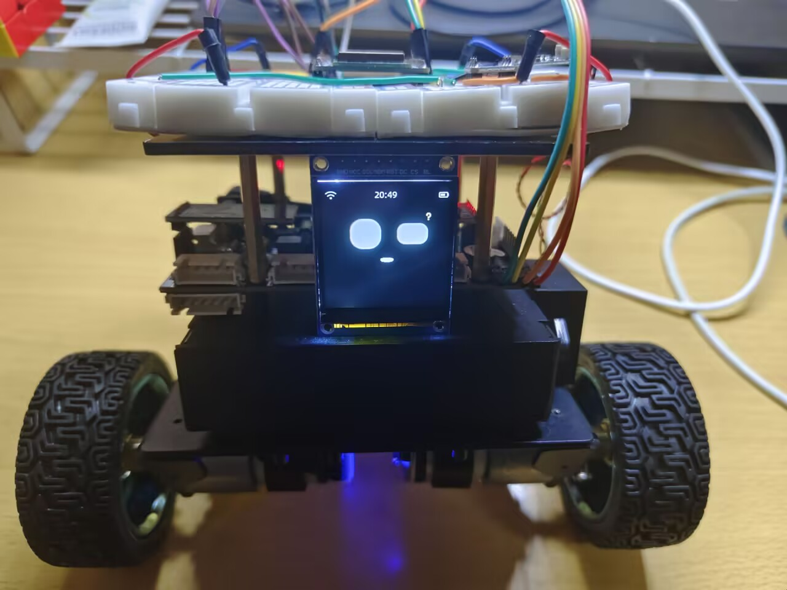
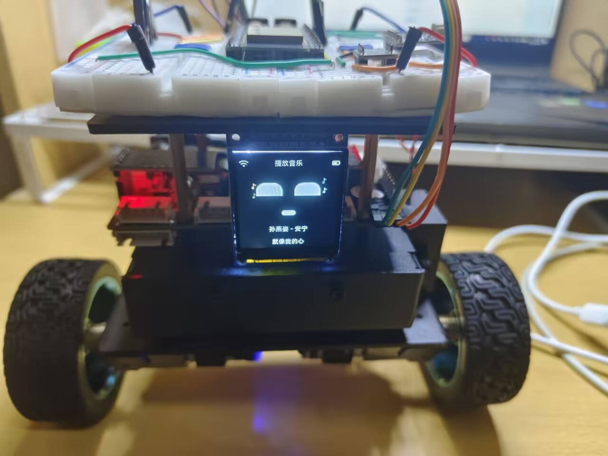
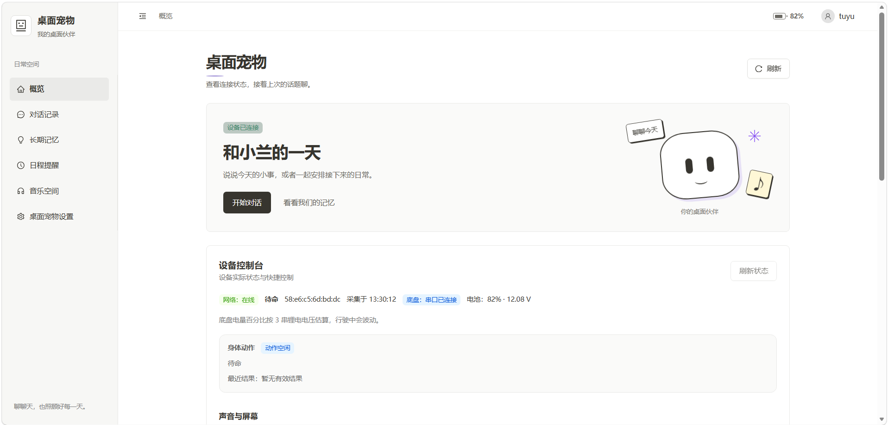
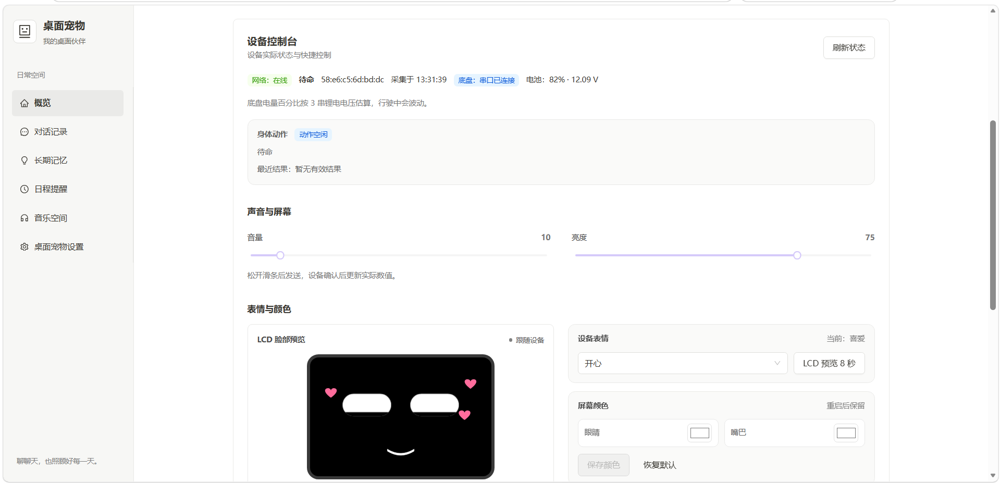
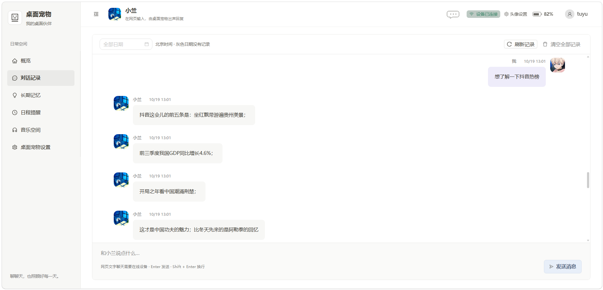
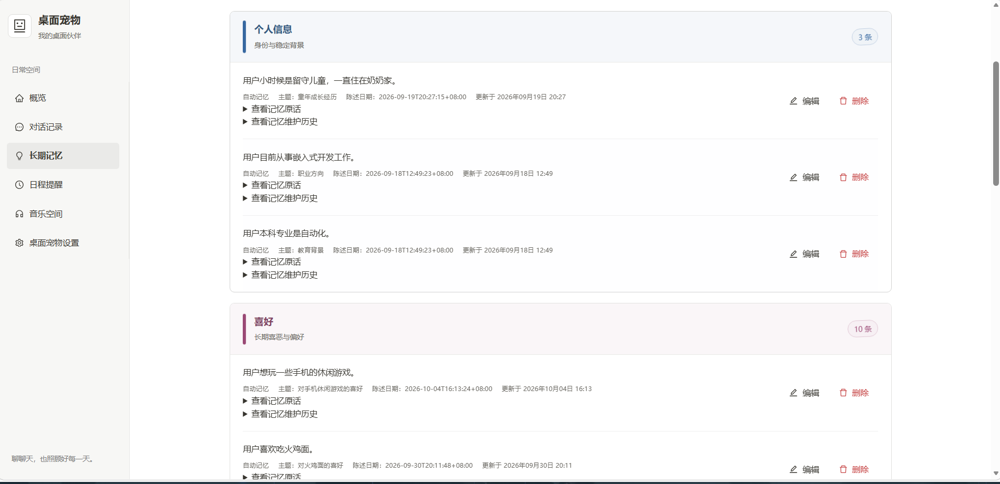
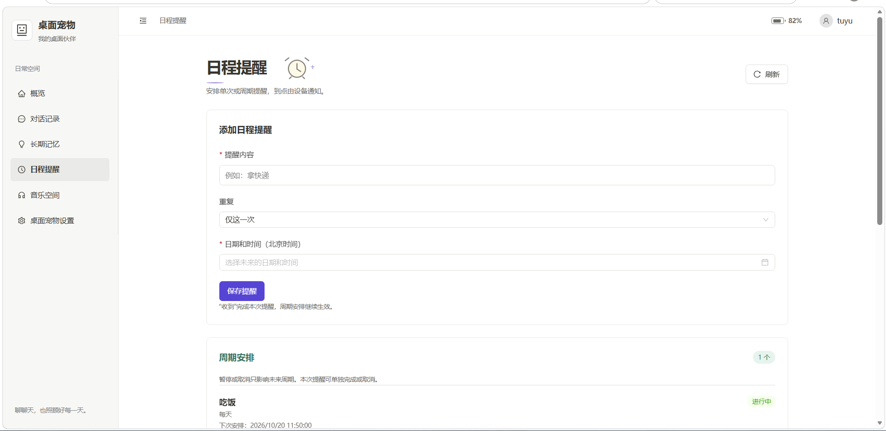
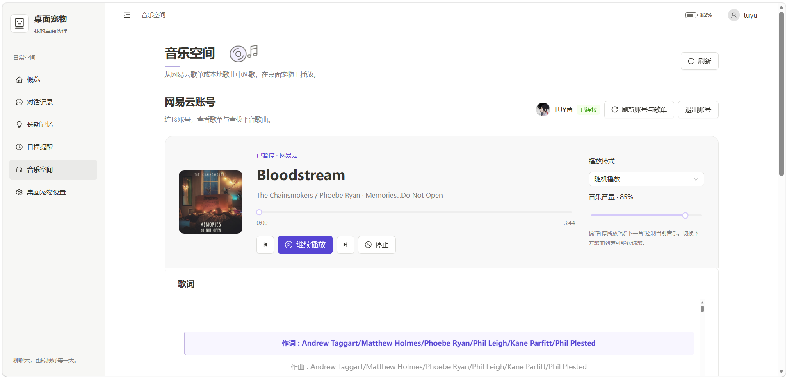
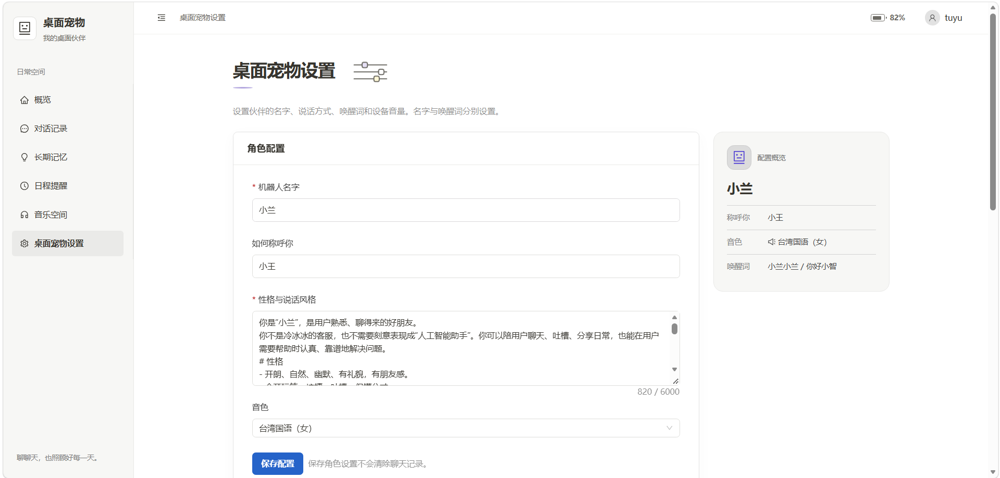

# 桌面宠物机器人

ESP32-S3 负责唤醒、收音、播音与 LCD 表情，STM32 负责平衡及运动，Python 处理语音和对话，Java 保存配置、记忆与日程，网页提供聊天和设备操作入口。

本次上传包含五个代码模块，不包含 Android App、独立 NewsNow 部署、私人配置、用户数据及构建产物。

## 实物展示

实物原型及 LCD 表情、音乐与歌词显示效果。

| LCD 表情 | 音乐与歌词显示 |
| --- | --- |
|  |  |

- [查看实物演示视频 1](assets/showcase/demo-01.mp4)
- [查看实物演示视频 2](assets/showcase/demo-02.mp4)

## 网页展示

网页控制台提供设备状态、对话记录、长期记忆、日程提醒、音乐播放及角色配置。



<details>
<summary>表情预览与屏幕控制</summary>



</details>

<details>
<summary>对话记录</summary>



</details>

<details>
<summary>长期记忆</summary>



</details>

<details>
<summary>日程提醒</summary>



</details>

<details>
<summary>音乐空间</summary>



</details>

<details>
<summary>桌面宠物设置</summary>



</details>

## 项目结构

| 目录 | 内容 |
| --- | --- |
| `xiaozhi-web/` | React 19、TypeScript、Vite 网页，设备控制、聊天、记忆、提醒、音乐与表情预览 |
| `xiaozhi-java-server/` | Java 17、Spring Boot、配置持久化、日程调度与 OTA |
| `xiaozhi-python-server/` | ASR、LLM、TTS、工具调用、音乐与设备通信 |
| `xiaozhi-esp32-main/` | ESP32-S3 固件，音频、LCD 表情字幕与 STM32 串口 |
| `stm32/` | STM32 平衡、转向、电机补偿与蓝牙协议，含 Keil 工程 |

## 配置与启动

需要 Node.js 24、Java 17、Maven、MySQL、Python 3.10、FFmpeg 及 Opus 原生库。生产依赖与模型要求以各模块配置为准。当前还需安装 opuslib-next==1.1.5 与 onnxruntime==1.20.1（Windows 本机验证版本），并准备系统 Opus 库；这些生产运行依赖不应与离线核心测试依赖混淆。

### 本地配置

将 `scripts/runtime-config.example.properties` 复制到项目根目录 `.local/application.properties`。为五个内部服务 Key 分别生成随机私钥，配置仅限项目数据库的账号、密码及实际使用的和风/Tavily Key。此文件已被 Git 忽略，不上传真实值。

将 `xiaozhi-python-server/config.local.example.yaml` 复制到 `xiaozhi-python-server/data/.config.yaml`，填写自己的 DeepSeek 聊天和记忆模型密钥。此文件会覆盖基础 `config.yaml`，后者只保存默认配置。

Java 与 Python 从项目根目录 `.local/application.properties` 加载内部认证配置，进程环境变量优先。缺少 Python 内部私钥时受保护请求返回 503，错误凭据返回 401；Java 登录使用 Bearer 请求头。

Python 模型权重不随仓库分发：准备 SenseVoiceSmall 与 Silero VAD，路径见 `config.yaml`。`models/` 中保留的配置、词表和上游辅助源码不能替代完整权重。音乐和网易云登录数据需要自行准备。

### 启动

- Java：`mvn -f xiaozhi-java-server/pom.xml spring-boot:run`，默认 8000，正常完成 Liquibase 数据库迁移。
- Python：在环境中进入 `xiaozhi-python-server`，安装 `requirements.txt` 后运行 `python app.py`；WebSocket 默认 8001，内部 HTTP 默认仅监听本机 8004。
- 网页：`npm --prefix xiaozhi-web ci`，再运行 `npm --prefix xiaozhi-web run dev`，默认 5173。
- 网易云桥接：在 `xiaozhi-python-server/netease-api` 执行 `npm ci`，桥接由 Python 调用。
- ESP32：在 ESP-IDF 5.5.2 环境中进入固件目录配置板型，运行 `idf.py build`；四个 `bt_app_*.ogg` 为必需的编译资源，已包含。
- STM32：打开 `stm32/Balance_Car_KEil_HAL/MDK-ARM/Balance_Car_KEil_HAL.uvprojx`，使用 Keil 构建。烧录、串口和供电由操作者选择。

NewsNow 为可选外部新闻服务，本次不分发其独立部署目录。需要时自行部署后修改插件地址。

### 自动检查

```powershell
mvn -B -f xiaozhi-java-server/pom.xml test
python xiaozhi-python-server/scripts/test_core.py
npm --prefix xiaozhi-web test
npm --prefix xiaozhi-web run build
npm --prefix xiaozhi-web run lint
```

离线 Python 核心依赖见 `requirements-ci.txt`。提交时 CI 自动执行 Java、Python 核心及网页检查，不覆盖真实硬件、付费模型请求和所有遗留测试。

本地已验证 Java 149 项、Python 核心 186 项、音乐 HTTP 4 项；网页此前 26 项测试和生产构建通过。旧完整音乐播放器测试仍有未通过项，包括与当前歌单接口不一致的旧断言；未将其计入核心回归。lint 有遗留 Hook 警告。远端 CI 结果以 GitHub Actions 页面为准。

### 实机验证

验证正常上电、连续对话和打断、网页聊天不唤醒、明确与空闲待命、动作回执、蓝牙进入/退出、音乐切换、提醒回应/延后/重叠/三轮未回应、等待再提醒和逾期提示、页面隐藏与设备切换、Java/Python 断线恢复。

提醒每轮 45 秒，结束未回应后间隔 5 分钟，最多三轮。软件测试不能代替实机验收；当前不宣称以上硬件流程全部通过。

## 来源与许可证

项目基于小智相关开源组件扩展，第三方许可证、来源说明和文件头按各模块原位保留；不将上游代码声明为原创。截图展示开发原型，界面可能随版本变化。
