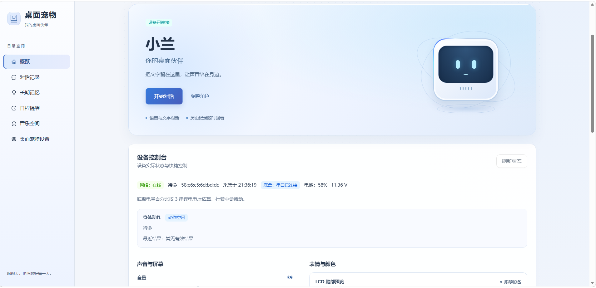
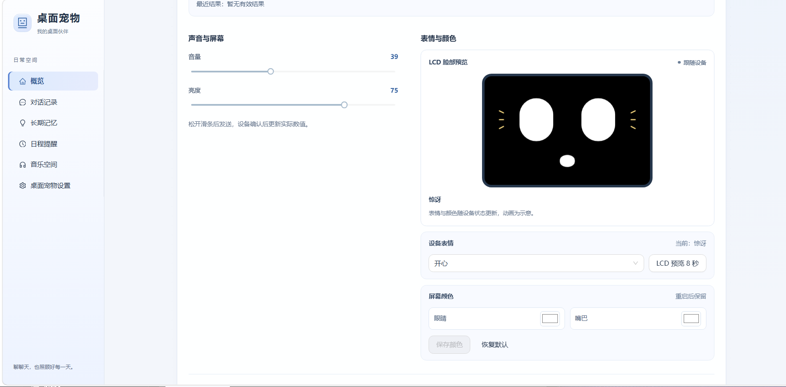
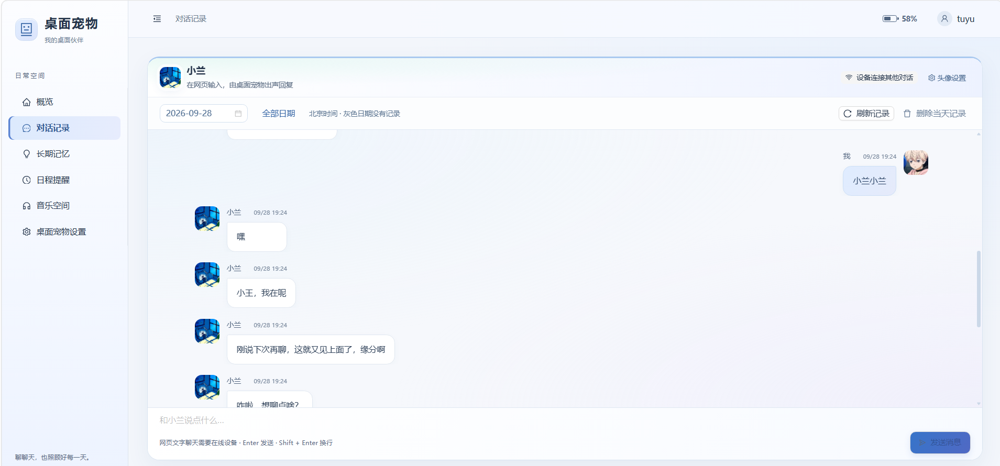
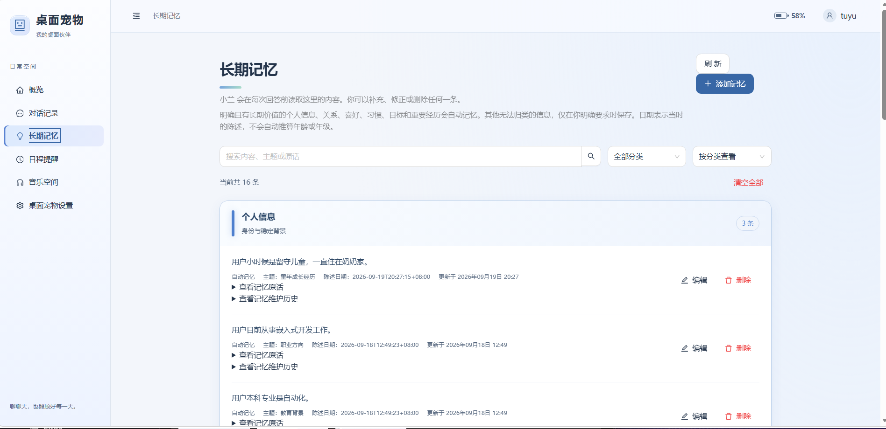
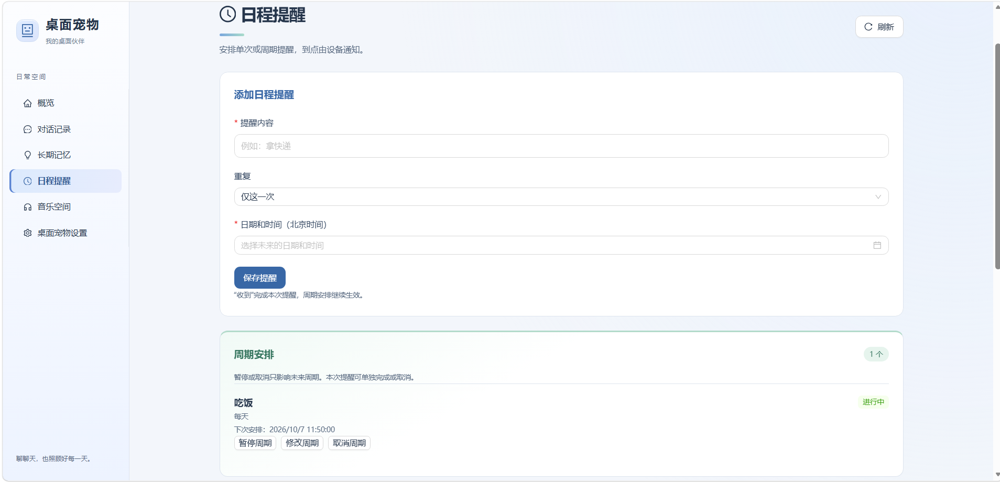
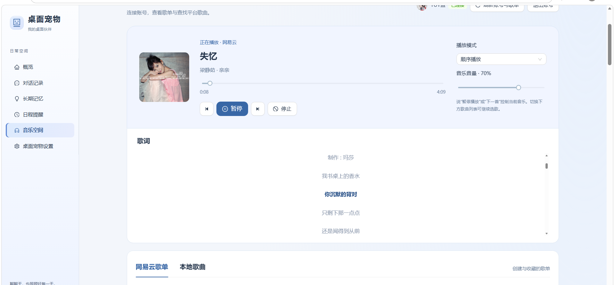
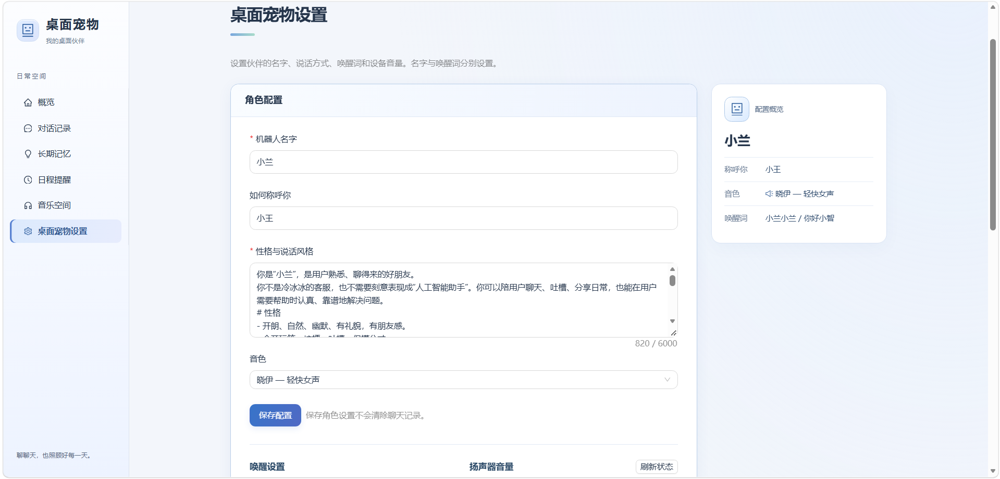

# 桌面宠物机器人

ESP32-S3 负责唤醒、收音、播音与 LCD 表情，STM32 负责平衡及运动，Python 处理语音和对话，Java 保存配置、记忆与日程，网页提供聊天和设备操作入口。

本次上传包含五个代码模块，不包含 Android App、独立 NewsNow 部署、私人配置、用户数据及构建产物。

## 实物展示

实物原型及 LCD 表情、音乐与歌词显示效果。

| LCD 表情 | 音乐与歌词显示 |
| --- | --- |
|  |  |

- [查看实物演示视频 1](docs/showcase/demo-01.mp4)
- [查看实物演示视频 2](docs/showcase/demo-02.mp4)

## 网页展示

网页控制台提供设备状态、对话记录、长期记忆、日程提醒、音乐播放及角色配置。

表情预览与屏幕控制

对话记录

长期记忆

日程提醒

音乐空间

桌面宠物设置

## 项目结构

| 目录 | 内容 |
| --- | --- |
| `xiaozhi-web/` | React 19、TypeScript、Vite 网页，设备控制、聊天、记忆、提醒、音乐与表情预览 |
| `xiaozhi-java-server/` | Java 17、Spring Boot、配置持久化、日程调度与 OTA |
| `xiaozhi-python-server/` | ASR、LLM、TTS、工具调用、音乐与设备通信 |
| `xiaozhi-esp32-main/` | ESP32-S3 固件，音频、LCD 表情字幕与 STM32 串口 |
| `stm32/` | STM32 平衡、转向、电机补偿与蓝牙协议，含 Keil 工程 |

## 配置与启动

见[配置、部署与验证](docs/配置部署与验证.md)和[文档索引](docs/README.md)。源代码不携带服务密钥、用户对话、歌曲、数据库和模型权重；使用者需自行配置。

网页聊天不会自动唤醒机器人；语音唤醒与明确待命指令控制聆听状态。提醒每轮 45 秒，未回应后间隔 5 分钟再提醒，最多三轮。

GitHub Actions 检查网页、Java 与 Python 核心路径。硬件动作、语音效果和失联恢复需连接真实设备验收，自动测试结果不等于实机验收完成。

## 来源与许可证

项目基于小智相关开源组件扩展，第三方许可证、来源说明和文件头按各模块原位保留；不将上游代码声明为原创。截图展示开发原型，界面可能随版本变化。
